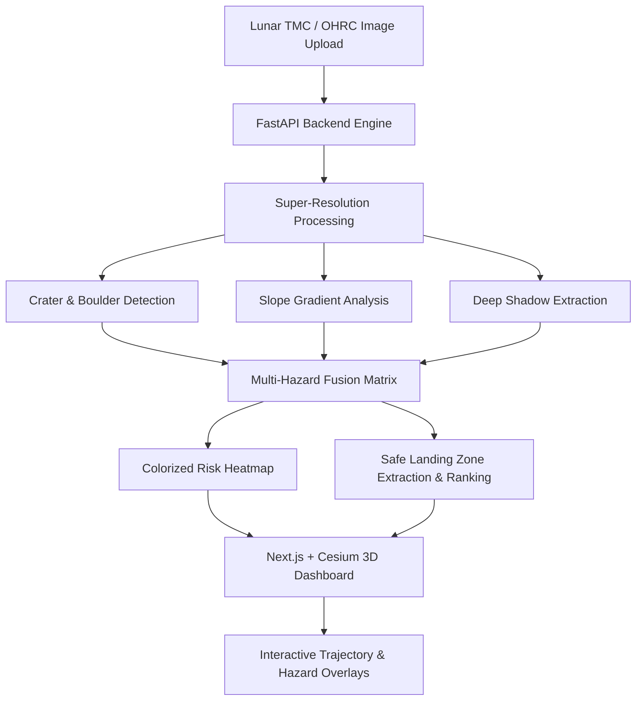

# 🌔 MoonGrid

> **AI-Powered Lunar Hazard Mapping & Autonomous Safe Landing Zone Detection System**

[](https://nextjs.org/)
[](https://fastapi.tiangolo.com/)
[](https://cesium.com/)
[](https://pytorch.org/)
[](https://postgis.net/)
[](https://www.typescriptlang.org/)

---

## 📌 Overview

**MoonGrid** is an advanced geospatial and computer vision platform designed to assist autonomous lunar landers (such as ISRO's Chandrayaan and NASA's Artemis missions) in identifying hazard-free touchdown sites on the lunar surface.

By processing high-resolution Terrain Mapping Camera (TMC) and Orbiter High-Resolution Camera (OHRC) imagery, MoonGrid applies super-resolution enhancement, detects micro-craters, boulders, steep slopes, and shadow zones, and outputs a weighted multi-hazard risk heatmap along with ranked safe landing zones.

---

## ✨ Key Features

- 🛰️ **Super-Resolution Image Enhancement:** Upscales optical lunar surface scans with edge-preserving sharpness to uncover hidden micro-topographical hazards.
- 🌋 **Automated Hazard Detection:**
  - **Craters & Depressions:** Morphological contour analysis and Faster R-CNN detection.
  - **Boulders & Rocks:** High-contrast blob segmentation and topological feature detection.
  - **Steep Slopes:** Sobel gradient intensity filters calculating surface incline risks.
  - **Deep Shadows:** Radiometric thresholding identifying hazardous, low-visibility regions.
- 🎛️ **Multi-Hazard Risk Fusion:** Weighted risk heatmap algorithm (*40% Craters + 30% Shadows + 30% Slopes*) classifying terrain into **Safe (Green)**, **Moderate (Amber)**, and **Hazardous (Red)**.
- 🎯 **Topological Safe Landing Zone Extraction:** Automatically identifies, bounds, and ranks candidate landing zones by safety score, clearance radius, and descent approach vector.
- 🌐 **Interactive 3D Lunar Digital Twin:** Built with **CesiumJS** to visualize landing sites on an interactive 3D Moon globe.
- 📊 **Scan History & Persistence:** Integrated SQLite / PostgreSQL + PostGIS database keeping complete audit logs of all processed scans.

---

## 🏗️ System Architecture



---

## 🛠️ Tech Stack

| Layer | Technologies |
| :--- | :--- |
| **Frontend** | Next.js 15, React 19, TypeScript, Tailwind CSS, Lucide Icons |
| **3D Visualization** | CesiumJS, Resium, WebGL |
| **Backend API** | FastAPI, Uvicorn, Pydantic, SQLAlchemy |
| **Computer Vision / ML** | PyTorch, OpenCV, NumPy, SciPy, Pillow, Scikit-Image |
| **Geospatial & Storage** | PostgreSQL 16, PostGIS, SQLite |

---

## 🚀 Getting Started

### Prerequisites
- **Node.js** (v18.0 or higher)
- **Python** (v3.10 or higher)
- **Git**

---

### 1. Clone the Repository
```bash
git clone https://github.com/rawchitt/MoonGrid.git
cd MoonGrid
```

---

### 2. Backend Setup (FastAPI)

```bash
# Navigate to backend
cd backend

# Create and activate virtual environment
python -m venv venv
# Windows:
venv\Scripts\activate
# macOS/Linux:
# source venv/bin/activate

# Install dependencies
pip install -r requirements.txt

# Run the backend server
uvicorn app.main:app --reload --host 0.0.0.0 --port 8000
```
API will be live at `http://localhost:8000`  
Interactive Swagger API docs: `http://localhost:8000/docs`

---

### 3. Frontend Setup (Next.js)

```bash
# Open a new terminal and navigate to frontend
cd frontend

# Install dependencies
npm install

# Start development server
npm run dev
```
Open [http://localhost:3000](http://localhost:3000) in your browser to view the interactive dashboard.

---

## 📡 API Endpoints

| Method | Endpoint | Description |
| :--- | :--- | :--- |
| `POST` | `/predict` | Uploads lunar optical image & returns hazard analysis JSON + visual overlays |
| `GET` | `/jobs` | Returns list of past prediction scans and summary metrics |
| `GET` | `/jobs/{id}` | Fetches full analysis data for a specific scan ID |
| `GET` | `/docs` | Interactive Swagger API documentation |

---

## 🔮 Roadmap

- [x] High-performance CV and morphological hazard detection pipeline
- [x] Multi-hazard risk map overlay and colorized heatmap generation
- [x] Next.js interactive UI with before/after comparison slider
- [x] CesiumJS 3D Lunar terrain rendering
- [ ] End-to-end SwinIR / ESRGAN deep-learning weights integration
- [ ] Sub-pixel Selenographic coordinate georeferencing (TMC metadata mapping)
- [ ] Real-time descent trajectory waypoint simulation

---

## 📄 License

This project is licensed under the **MIT License** - see the [LICENSE](LICENSE) file for details.

---

<p align="center">
  Developed with ❤️ for space exploration and autonomous planetary exploration.
</p>
